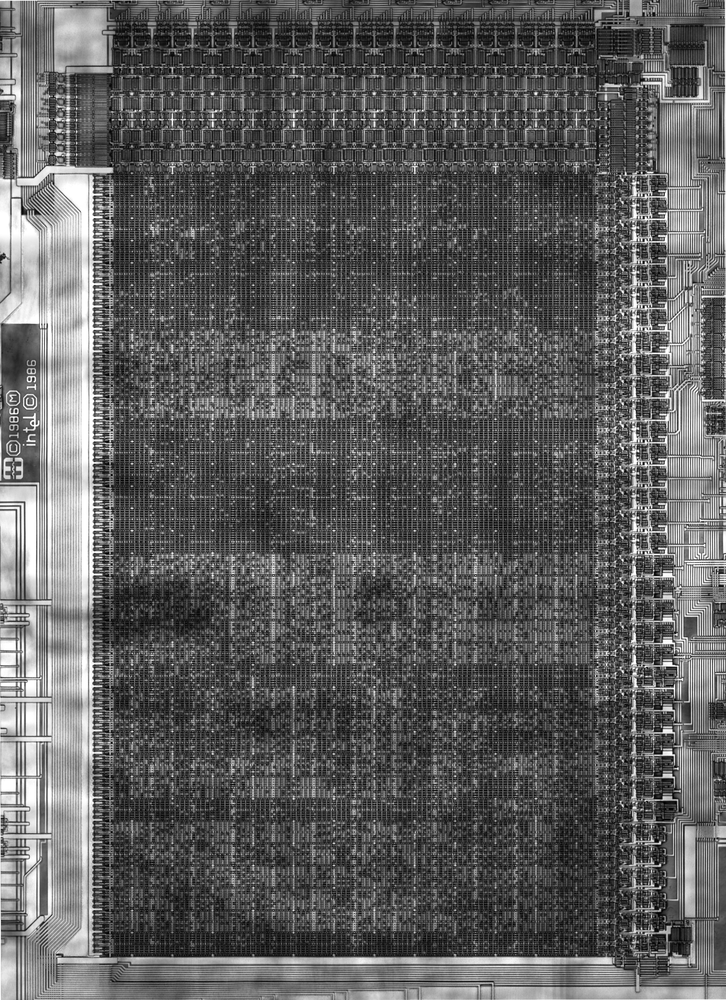

# The Intel/Harris 80C286 Microcode

The NMOS 80286 microcode array contains 192x280 or 53,760 bits. This array defines 1,536 35-bit words with 8 microcode words per column.

## Previous Imaging Efforts

The Intel NMOS 80286 CPU was delayered and imaged, only to discover that the microcode array was implemented as an implant ROM and was unreadable.

In 2026, experiments with NIR photography on a CMOS 80286 revealed that the microcode bits were theoretically readable.

*NIR photography of 80C286 performed by 0x31337*

Unfortunately the resolution was not sufficient for reliable bit extraction.

## New Imaging (2026)

New delayering and imaging was comissioned from [InfoSecDJ](https://siliconpr0n.org/archive/doku.php?id=infosecdj:start) on a Harris 80C286 CPU. 

